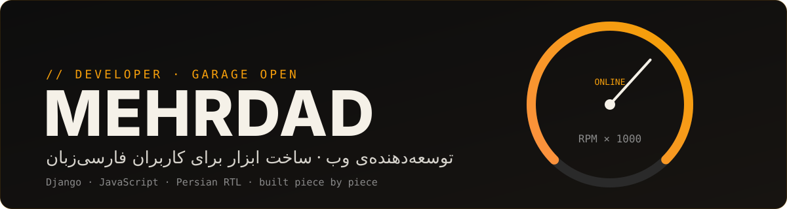
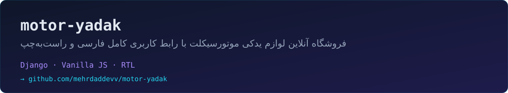

<div align="center">
  
</div>

<br/>

<div align="center">

[](#)
[](#)
[](https://github.com/mehrdaddevv?tab=followers)
[](https://github.com/mehrdaddevv/mehrdaddevv/commits/main)

</div>

---

### 🔧 Odometer

<div align="center">


</div>

### ⚙️ Gear Selector

<div align="center">


</div>

### 🏍️ Garage

<a href="https://github.com/mehrdaddevv/motor-yadak"></a>

### 🛠️ Service Log

```text
mehrdad@garage:~$ status
  ▸ in progress   motor-yadak       فروشگاه لوازم یدکی با Django
  ▸ learning      system design     مقیاس‌پذیری و کش
  ▸ available     freelance / collab پروژه‌های وب با تمرکز بر فارسی
```

### 📝 Shop Rules

| | |
|---|---|
| **Clean code** | کدی که شش ماه بعد هم بتوانم بخوانم، بهترین کد است. |
| **RTL from day one** | جهت متن و فونت را از اول طراحی می‌کنم، نه در آخر کار. |
| **Ship, then tune** | نسخه‌ی کارا را زودتر منتشر می‌کنم و بعد بهینه‌سازی می‌کنم. |

<div dir="rtl">

**سلام!** من مهرداد هستم. اگر ایده‌ای داری، یا دنبال کسی برای ساخت یک وب‌اپ فارسی هستی، خوشحال می‌شوم بشنوم.

</div>

### 📡 Ride With Me

<div align="center">

[](mailto:you@example.com)
[](https://github.com/mehrdaddevv?tab=repositories)

</div>
