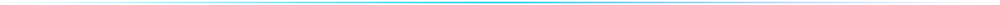

<div align="center">
  
</div>

<div align="center">
  
</div>

<div align="center">
  <br />

  [](#)
  [](#)
  [](#)
  [](https://github.com/mehrdaddevv?tab=followers)
  [](https://github.com/mehrdaddevv/mehrdaddevv/commits/main)

</div>



##  &nbsp;// The short version

من روی ساخت **وب‌اپلیکیشن‌های تمیز و سریع** با **Django** و **JavaScript** کار می‌کنم. علاقه‌ی خاصی به **رابط‌های راست‌به‌چپ و فارسی** دارم؛ جایی که زبان کاربر یک اولویت از همان خط اول کد است، نه یک ترجمه‌ی بعدی.

<div dir="rtl">
  <p>
    <b>فارسی:</b> من برنامه‌نویس هستم و محصولاتی می‌سازم که ساده، سریع و برای کاربر فارسی‌زبان طراحی شده باشند. هر پروژه را از ساختار داده تا رابط کاربری با دقت می‌سازم.
  </p>
</div>


##  &nbsp;// Arsenal

<div align="center">


</div>


##  &nbsp;// Featured work

<a href="https://github.com/mehrdaddevv/motor-yadak"></a>


##  &nbsp;// Code of the road

<table>
  <tr>
    <td width="33%" valign="top">
      <h3>🧩 Clarity first</h3>
      <p align="left">کد باید در شش ماه بعد هم قابل‌فهم باشد. ساده‌ترین راه‌حلی که درست کار کند را انتخاب می‌کنم.</p>
    </td>
    <td width="33%" valign="top">
      <h3>🔤 RTL is architecture</h3>
      <p align="left">جهت متن، فونت و اعداد از ابتدای طراحی تعیین می‌شوند، نه با یک استایل وصله‌شده در آخر کار.</p>
    </td>
    <td width="33%" valign="top">
      <h3>🚀 Ship, then polish</h3>
      <p align="left">نسخه‌ی کارا زودتر منتشر می‌شود. بازخورد واقعی کاربر بهتر از حدس‌های طولانی است.</p>
    </td>
  </tr>
</table>


##  &nbsp;// Currently

```console
mehrdad@dev:~$ status

  ▸ building   motor-yadak     فروشگاه لوازم یدکی موتور با Django
  ▸ learning   system design   طراحی سیستم‌های مقیاس‌پذیر
  ▸ open to    collabs         پروژه‌های وب با تمرکز بر UX فارسی
```


##  &nbsp;// Reach out

<div align="center">
  <p>ایده‌ای داری یا می‌خواهی روی پروژه‌ای همکاری کنیم؟ از طریق یکی از راه‌های زیر پیام بده.</p>

  <a href="mailto:you@example.com">
    
  </a>
  &nbsp;
  <a href="https://github.com/mehrdaddevv?tab=repositories">
    
  </a>

  <br /><br />

  
</div>
